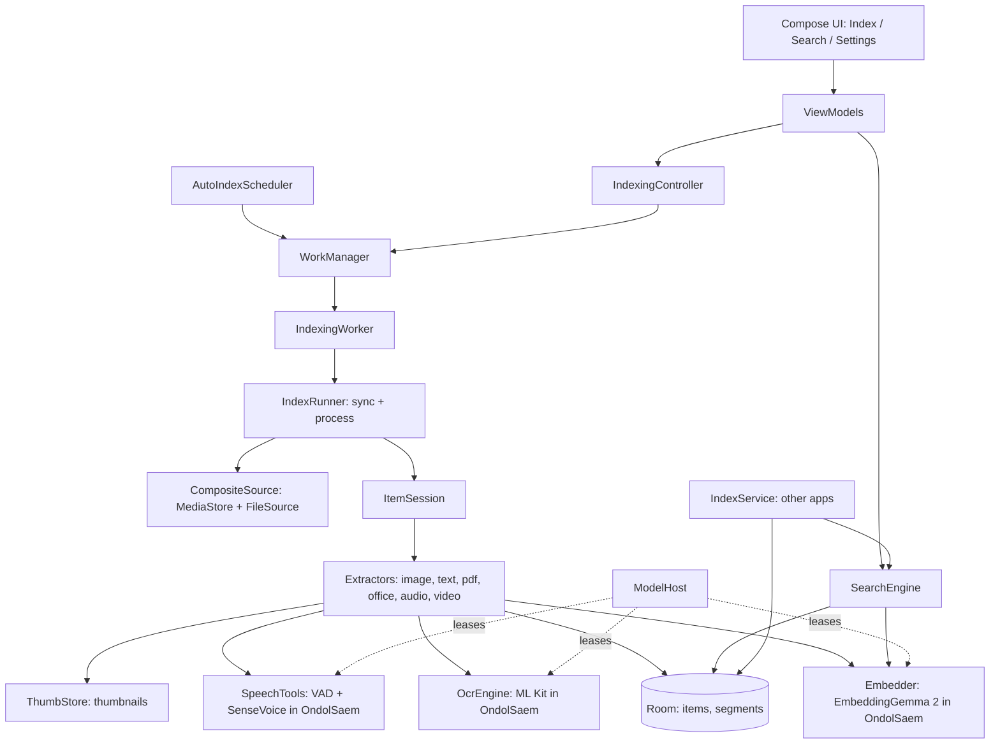

# Architecture

Code package and Gradle `namespace` `com.lsa.app` (Kotlin, Jetpack Compose); the installed app id (`applicationId`) is `io.github.taehunkim.nunsori`. Source root: `app/src/main/java/com/lsa/app`.

## 1. Goals and principles

- **On-device only.** Embedding, OCR, speech recognition and face recognition run on the phone (the chat is the companion app Malbotdari, [section 11](#11-index-api-other-apps)). Nunsori has no network permission ([privacy](privacy.md)).
- **Models live in the companion app OndolSaem.** It downloads them, keeps them in memory and serves them over a bound service (SDK `com.github.sonanjip:ondolsaem` on JitPack); `ml/ModelHost` is the only place that talks to it ([models](models.md)).
- **One data model for every file type.** A file is an `item`; what is searched is a `segment`. New file types only add extractors and segment types.
- **Resumable.** Work is committed per file and checkpointed per segment batch, so a killed process resumes where it stopped.

## 2. System overview

## 3. Package map

| Package | Responsibility |
|---|---|
| `data/db` | Room entities, `ItemDao`, `Migrations.kt` |
| `data/media` | `MediaStoreRepository` (images, audio, video), `FileSource` (text and documents, needs All files access), `CompositeSource` |
| `data/prefs` | `SettingsStore` (DataStore): kinds, folders, mirrored model ids, auto-index mode |
| `indexing` | `IndexRunner`, `ItemSession`, `IndexingController`, `IndexingWorker`, `AutoIndexScheduler`, `PipelineKeys`, `ImageExtractor` |
| `indexing/text` | `TextExtractor`, `TextChunker`, `MarkdownChunker`, `TextFormats`, `TextDecoder`, `TextRouting` |
| `indexing/docs` | `PdfExtractor`, `PdfText`, `OfficeExtractor`, `OfficeParsers`, `TextCard`, `ThumbStore`, `ZipSource` |
| `indexing/places` | `PlaceFinder`: offline GPS to place name (GeoNames cities, English and Korean) |
| `indexing/audio` | `AudioExtractor`, `AudioDecoder`, `Pcm` (window planning), `SpeechTools` |
| `indexing/video` | `VideoExtractor`, `VideoClips` |
| `indexing/faces` | `FaceIndexer` (face pass after indexing, crops, off/on), `FaceClusterer` (grouping, merging, grouping everything again with a new threshold while keeping names), `ui/people/FaceThresholdDialog` |
| `ml`, `ml/embedding`, `ml/ocr`, `ml/faces` | `ModelHost` (OndolSaem client: leases, remote engines, model-id mirroring), interfaces `Embedder`, `OcrEngine`, `FaceDetector` (`SpeechTools` is in `indexing/audio`) |
| `service` | The index for other apps: `IndexService` (bound service), `IndexApi`, `CallerCheck` + `Approvals`, `IndexEvents` (index-changed hints), `OpenItemActivity`, `Malbotdari` (opening the chat app) |
| `service/tools` | `SearchIndexTool`, `ReadFileTool`, `SearchInFileTool` (`search_index`, `read_file`, `search_in_file`), `FileActionPrep` + `FileActionTools` (`move_files`, `delete_files`), `FileOps` (move, trash, delete + index update), `PeopleDirectory` (names for the `person` arguments) |
| `search` | `SearchEngine`, `Fusion`, `KeywordMatcher` |
| `ui` | `AppScaffold` (shows `OnboardingScreen` until `onboarding_done`; drawer menu on the lists, an up arrow to the list on detail routes such as `people/{id}` and `settings/apps`; the Chat entry opens Malbotdari), screens (`index`, `search`, `people`, `settings`, `onboarding`), `theme`; `settings/SettingsSections.kt` holds the kinds, folders and embedding-model sections shared by Settings and the wizard |

## 4. Data model

Defined in `data/db/Entities.kt`.

**`items`** (one row per file): `sourceKey` (unique id of the source file), `kind` (`IMAGE, TEXT, DOC, AUDIO, VIDEO`), `uri`, `folderKey`
(same form as MediaStore `RELATIVE_PATH`), `displayName`, `mimeType`, `sizeBytes`, `modifiedAt`, `title`, `durationMs`, `pageCount`,
`width/height`, `dateTaken`, `latitude/longitude`, `place` (searchable place names, v3), `status` (`IN_PROGRESS, DONE, FAILED, SKIPPED`), `error`, `embeddingModelId`,
`pipelineKey`, `progress`, `indexedAt`.

**`segments`** (what is searched): `itemId`, `type`, `ordinal`, `startMs/endMs` (audio, video), `page`, `text`, `embedding`, `thumbPath`.

**`indexed_folders`**: `relativePath`, `enabled`, `recursive`.

**`people`** (`name` or null, `coverFaceId`, timestamps) and **`faces`** (`itemId` with cascade delete, box in 0..1, `score`, int8 128-d `vector`, `personId` set to null when its person is deleted, `blockedPersonId` = the group the user took it out of, `thumbPath` of the crop), added in v8 together with `items.faceKey` (face model key a photo was scanned with; null = not scanned). See [indexing.md](indexing.md#faces).

The chat tables (`chat_sessions`, `chat_messages`, `scheduled_tasks`, `pending_actions`, v4 to v7) were dropped in v9 when the chat moved to Malbotdari.

| `SegmentType` | Produced by | Signal group |
|---|---|---|
| `IMAGE` | images | VISUAL |
| `OCR_TEXT` | images (ML Kit) | TEXT |
| `TEXT_CHUNK` | text files, document text | TEXT |
| `PAGE_IMAGE` | PDF pages | VISUAL |
| `CARD_IMAGE` | Office text cards | VISUAL |
| `TRANSCRIPT` | audio and video speech | TEXT |
| `AUDIO_CLIP` | audio windows (740M only) | AUDIO |
| `VIDEO_CLIP` | video clips | VISUAL |

**Vector format.** int8, stored as `[scale: float32][int8 × dim]` (`Quant`), 768 dims. Dot products are done in memory over all vectors.

**Migrations.** The schema is at **v9** (`AppDatabase.VERSION`; v3 added `items.place`, v4 the chat tables, v5 pinned chats, v6 scheduled tasks, v7 action cards, v8 faces and people, v9 dropped the chat tables; `MIGRATION_8_9` reports the dropped task ids so `AppUpgrade.cancelChatAlarms` cancels their alarms). `Migrations.kt` holds one `Migration` per step and the ordered `ALL_MIGRATIONS` list that `LsaApplication` registers. There is no destructive fallback on upgrade; only a downgrade (older build over a newer one) rebuilds the index, because it is derived data. Derived data that can be recomputed without a schema change is handled by `pipelineKey` instead. Policy: [development.md](development.md#schema-and-version-changes).

**App upgrades.** `AppUpgrade.run` (called from `LsaApplication`) compares the stored `last_version_code` with `BuildConfig.VERSION_CODE` and runs per-release steps for settings or file-layout changes. Auto Backup is disabled (`allowBackup="false"`): the index is derived and a restored database would not match missing thumbnails and models.

## 5. Indexing flow

Details in [indexing.md](indexing.md).

1. `IndexRunner.sync()` needs no model. It lists files from the sources, deletes rows whose file is gone, updates moved files, and computes the to-do set (new, changed, or `pipelineKey` differs). An empty listing never deletes anything (safety against revoked permission or unmounted storage).
2. `IndexRunner.process()` handles the to-do set one file at a time. `ItemSession` picks the extractor by kind; the extractor streams segments to a sink that commits them with the new `progress` value.
3. `pipelineKey` (`PipelineKeys.kt`) encodes everything that changes a kind's output: model id, chunker version, video precision, and so on. When it changes, only that kind is reprocessed.
4. Extractors throw `SkipItem` for unsupported, protected or too-large files; the item becomes `SKIPPED` with a reason.

## 6. Background execution

| Mode (`AutoIndexMode`) | Mechanism |
|---|---|
| MANUAL | User presses Start; work runs as foreground work with a notification |
| IMMEDIATE | WorkManager content-URI trigger on MediaStore (works while the app is dead), 15 s update delay, 2 min max delay |
| SCHEDULED | Periodic work at a chosen time, optional "charging only" |
| IDLE | A check every 15 minutes while charging (`IDLE_CHECK_MIN`); the worker runs the pass only when OndolSaem SDK's `IdleRule` says idle: charging and the screen off for 10/30/60 min at ≥ 90 % / 70–89 % / < 70 % battery (preset Normal; Sooner 5/15/30, Later 30/60/120, Settings). Screen-off times come from `IdleState` (a runtime receiver while the app runs, else the first check that sees the screen off). The pass stops when the screen turns on and continues at the next idle check |

Automatic runs cannot start foreground services from the background on recent Android, so `setForeground` is attempted inside try/catch. `IndexingController` serialises runs (`runLock`), and a thermal gate pauses automatic runs when the device is hot. The mode is chosen on first launch.

## 7. Model lifetime

Models are loaded and unloaded by OndolSaem, with a residency policy per category set there (keep loaded, unload right after use, or after 1 to 15 minutes). `ModelHost.embedder()/ocr()/speech()/faces()` return a `Lease` that also holds a lease in OndolSaem, so a model stays loaded while Nunsori uses it: an indexing pass holds the embedder and OCR leases for the whole pass; a search (also one from another app's `search_index`) holds the embedder while it runs. When OndolSaem is not installed, refuses the connection or has no model for a category, the lease is null and the screens show a hint (`HostState`). The optional resource indicator (`ui/common/ResourceIndicator.kt`) shows whether OndolSaem is connected plus this process's memory and CPU; the models' memory is on OndolSaem's dashboard. Log tag `LSA.ModelHost`.

## 8. Search (summary)

Segments are scored per signal group (VISUAL, TEXT, AUDIO) with a median-spread gate and relative scaling, combined with SQL `LIKE` keyword matches, grouped per item, and shown with the best location (page or time). See [search.md](search.md).

## 9. Design decisions

| Decision | Why | Alternative rejected |
|---|---|---|
| WorkManager content-URI trigger for IMMEDIATE | Works when the process is dead | `ContentObserver` (only while the app lives) |
| Relative score per signal group | Cosine ranges differ by space (unrelated OCR text still scores about 0.6) | Reciprocal rank fusion: ranks ignore how good the best hit is, so nonsense queries still return results |
| int8 vectors, full in-memory scan | Simple, fast enough to about 300k segments | ANN index (complexity, not needed yet) |
| SQL `LIKE` keywords | No extra index to maintain | FTS5 trigram (revisit if slow) |
| All files access for text and documents | MediaStore does not expose documents reliably | Storage Access Framework per folder |
| Office files become text + generated card image | Phones cannot render Office documents | Server-side rendering (not on-device) |
| Audio in two stages (transcript, then clips) | Speech recognition is cheap, audio embedding needs the 740M model; each stage checkpoints separately | One combined pass |
| Video as scene/length clips, up to 8 frames each | Several frames in one request give one vector (measured) | Per-frame vectors (storage) |

## 10. Limits and extension points

- About 300k segments is the target for the in-memory scan; beyond that add ANN or smaller (256-d) vectors.
- Keyword search is `LIKE`; move to FTS5 trigram if it slows down.
- New embedding or OCR models: see [models.md](models.md#adding-a-model).
- Known limits and plans: [roadmap.md](roadmap.md).

## 11. Index API (other apps)

Other apps on the phone (the assistant app Malbotdari, apps the user allowed) use the index through a bound service, so the chat can live in its own app and later apps (a notes app) can reuse the same index. The contract is the `:sdk` module of this repository (`io.github.taehunkim.nunsori.sdk`, AIDL `INunsori`, client `NunsoriClient`); the app depends on the same module.

- `service/IndexService` binds on `io.github.taehunkim.nunsori.action.BIND` and runs every call through `CallerCheck`: apps signed with Nunsori's key pass; any other app needs the user's approval (`Approvals`, per package and certificate, stored as JSON in `SettingsStore.apiApprovalsJson`). The first call of an unknown app records a request, posts a notification and is refused with `NOT_APPROVED`; **Settings › App › Connected apps** (`ui/settings/ConnectedAppsScreen`, route `settings/apps`, also opened by `Nunsori.ACTION_APPROVE`) allows, denies or removes it.
- `service/IndexApi` is the logic: `tools`/`runTool` serve `search_index`, `read_file` and `search_in_file` (`service/tools`; the last ranks the passages of one file by cosine to the query, words when no model, so a chat reads only those) and prepare `move_files`/`delete_files` as a confirmation (the files and a payload) that the calling app shows to the user; `commit` then moves or trashes them with `FileOps` (needs All files access, else error `NEEDS_FILE_ACCESS`). `items`, `thumbnail` (JPEG through a pipe), `readText`, `matchItems` and `people` give what a chat shows and judges.
- New files: `changesSince(cursor)` returns finished items with `indexedAt` after the cursor (`ItemDao.doneAfter`, oldest first) and the next cursor; cursor 0 returns only the current position. After a pass that indexed files, `IndexingWorker` calls `IndexEvents.notifyChanged`, an explicit broadcast without data (`ACTION_INDEX_CHANGED`) to every app with a receiver for it (the SDK declares `IndexChangedReceiver`); they then ask `changesSince`. A missed hint costs nothing but delay: the cursor still covers the files.
- `service/OpenItemActivity` (`ACTION_OPEN_ITEM`, no UI) opens one file in the viewer the user picks; other apps never get the file itself.
